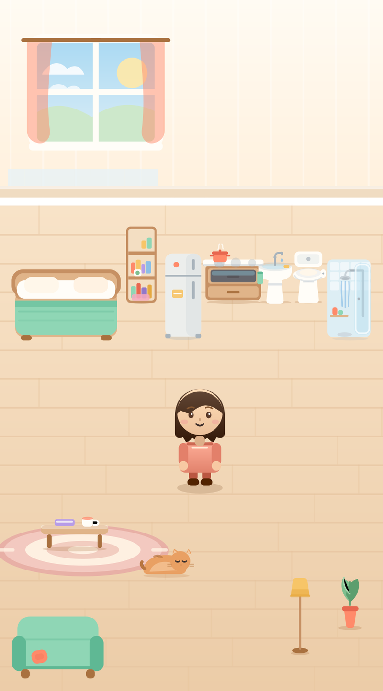

# Vida Online

> Simulação de vida relaxante para celular, direto no navegador.
> Cuide do seu personagem, decore a casa e, em breve, visite os amigos.



**Status: Fase 1 — solo jogável.** O jogo já tem criação de personagem em 5
etapas, movimento por toque com pathfinding, 5 objetos interativos (cama,
geladeira, chuveiro, banheiro, sofá) que alteram as necessidades, loop de
necessidades ligado ao relógio, sono com despertar automático, tutorial guiado,
áudio lo-fi procedural e persistência completa.

Este é um projeto original: nenhum nome, marca, interface, asset ou personagem
de jogos existentes foi usado. O gênero "simulação de vida" é inspiração, não
cópia.

Este repositório é um **monorepo** com o cliente web e um pacote de regras
compartilhado. O servidor (Fases 3–4) entrará em `apps/server`, reaproveitando
o mesmo pacote de regras — é isso que garante que cliente e servidor nunca
"discordem" sobre o resultado de uma ação.

---

## Índice

1. [O que já funciona (Fase 1)](#o-que-já-funciona-fase-1)
2. [Como rodar](#como-rodar)
3. [Como testar no celular](#como-testar-no-celular)
4. [Arquitetura em 5 linhas](#arquitetura-em-5-linhas)
5. [Estrutura de pastas](#estrutura-de-pastas)
6. [Dependências e por que cada uma existe](#dependências-e-por-que-cada-uma-existe)
7. [Sistema de arte procedural](#sistema-de-arte-procedural)
8. [Decisões técnicas](#decisões-técnicas)
9. [Testes](#testes)
10. [Acessibilidade](#acessibilidade)
11. [Desempenho e PWA](#desempenho-e-pwa)
12. [Suposições registradas](#suposições-registradas)
13. [Critérios de aceite da Fase 1](#critérios-de-aceite-da-fase-1)
14. [Pendências e próximos passos (Fase 2)](#pendências-e-próximos-passos-fase-2)
15. [Mudanças de arquivos na Fase 1](#mudanças-de-arquivos-na-fase-1)

---

## O que já funciona (Fase 1)

| Área | Entregue |
| --- | --- |
| **Criação de personagem** | 5 etapas (nome/idade/gênero → corpo → cabelo, rosto e roupa → 5 de 20 traços → aspiração de vida), prévia ao vivo em corpo inteiro + busto, rascunho salvo ao sair |
| **Movimento** | Toque no chão → `findPath` (BFS na grade 22×16) → caminhada interpolada a 74 px/s com 2 frames de passo, não atravessa móveis, ignora toques na parede |
| **Objetos interativos** | Cama (dormir/cochilar), geladeira (comer/cozinhar/beber água), chuveiro (banho/lavar mãos), banheiro, sofá (relaxar/assistir/ouvir música), fogão, pia, estante, mesinha, gato — ações com duração, efeitos nas necessidades, barra de progresso e botão "Pular" |
| **Animações** | Deitado na cama (−78°), sentado no sofá, balanço ao cozinhar, bolhas de emoji ("🍽️", "💤"), vapor no chuveiro, piscada e respiração, gato respirando |
| **Loop de necessidades** | 7 necessidades com decaimento por hora de jogo, crítico < 20 com atalho "!" no HUD (leva ao objeto que resolve), humor agregado, efeitos do catálogo aplicados proporcionalmente durante a ação |
| **Sono** | 30× mais rápido; acorda sozinho ao encher a energia, ao ficar com fome (≤ 15) ou após o horário do sono; aviso claro ao acordar |
| **Relógio** | 1 dia = 24 min reais (12/24/48 min nos Ajustes), dia/noite na cena (sol, luar, luzes acesas), relógio do HUD sincronizado com a simulação |
| **Persistência** | Necessidades, relógio, posição, ação em andamento, tutorial e dinheiro salvos; catch-up de até 8 h de jogo ao reabrir; backup e migração v2 |
| **Tutorial** | 5 passos guiados por flags no save (andar → comer → tomar banho → banheiro → dormir), com "Mostrar onde é" (pulsa o móvel) e "Pular" |
| **Áudio** | Trilha lo-fi procedural (Fmaj7–Em7–Dm7–Cmaj7, pad + baixo + hi-hat) e 11 efeitos curtos, volumes e vibração pelos Ajustes, desbloqueio no primeiro toque |
| **HUD** | Relógio, dia, dinheiro, humor, 7 barras `role="meter"`, retrato do personagem, pausa, esconder HUD, avisos de necessidade crítica |
| **Base da Fase 0** | PWA instalável e offline, i18n PT/EN, tema, acessibilidade, configurações, código de amigo |

Ainda **não** existe (planejado para as próximas fases): IA autônoma, emoções,
carreiras, loja, construção, bairro, contas e multiplayer.

---

## Como rodar

Pré-requisitos: **Node.js 22+** e **pnpm 12+** (`corepack enable pnpm`).

```bash
pnpm install          # instala o monorepo inteiro
pnpm dev              # abre o cliente em http://localhost:5173
```

Outros comandos:

```bash
pnpm build            # build de produção (PWA + service worker em apps/web/dist)
pnpm preview          # serve o build de produção em http://localhost:4173
pnpm typecheck        # TypeScript em todos os pacotes
pnpm test             # testes de todos os pacotes
pnpm check            # typecheck + test + build (o "CI local")
pnpm icons            # regera os PNGs de ícone a partir dos SVGs
```

Scripts auxiliares de arte (não fazem parte do build, apenas revisão visual):

```bash
cd apps/web
npx tsx scripts/preview-room.ts /tmp/room.png 2      # sala completa (personagem no centro)
npx tsx scripts/preview-character.ts /tmp/characters.png
```

`preview-room.ts` monta **um único SVG 400×720** (fundo + móveis na ordem de
profundidade + personagem) usando as mesmas funções de geometria da cena e
rasteriza uma vez com `sharp`; é a forma mais rápida de revisar a composição sem
abrir o navegador. `preview-layout.ts` é o script antigo (layout da Fase 0),
mantido só como referência histórica.

---

## Como testar no celular

1. Rode `pnpm dev` no computador.
2. Descubra o IP da máquina na rede local (`ipconfig` / `ifconfig`).
3. Abra `http://SEU_IP:5173` no celular (mesma rede Wi-Fi).
4. Para testar como app instalado, use `pnpm build && pnpm preview` e acesse pela
   mesma URL com HTTPS (o PWA exige HTTPS, exceto em `localhost`). A forma mais
   simples em rede local é usar o modo de desenvolvedor do Chrome
   (`chrome://inspect`) ou publicar o build em Vercel/Netlify.
5. No iPhone: Compartilhar → “Adicionar à Tela de Início”.

Dicas de teste:

- **Duas abas** abrem duas sessões separadas do jogo (útil para o multiplayer
  das próximas fases).
- O botão de pausa no HUD congela relógio e animações; o jogo retoma de onde parou.
- O salvamento acontece automaticamente. Para zerar, va em **Ajustes → Apagar
  progresso local** (no rodapé do menu, cartão “Sobre”).

---

## Arquitetura em 5 linhas

1. **React** desenha todas as telas e o HUD (DOM, acessível, fácil de traduzir).
2. **Phaser** desenha apenas o mundo do jogo (a casa), dentro de um único `<div>`.
3. Os dois conversam por uma **ponte de eventos tipada**, nunca por estado de frame
   em frame: o HUD só recebe "mudou a hora" e "tocou no objeto".
4. Todas as regras (relógio, necessidades, catálogo, grade, salvamento) vivem em
   **`packages/shared`**, que o servidor futuro vai importar sem alterações.
5. **Zustand** guarda o save e as preferências; o `localStorage` é acessado por uma
   camada tolerante a falhas, com backup e migração de versão.

---

## Estrutura de pastas

```
vida-online/
├── apps/
│   └── web/                      # Cliente (React + Phaser + PWA)
│       ├── public/
│       │   ├── brand/            # Logo (SVG + PNG de prévia)
│       │   ├── icons/            # Ícones do manifest + maskable
│       │   └── favicon.svg, apple-touch-icon.png
│       ├── scripts/              # Geradores de arte/ícones (dev, fora do build)
│       └── src/
│           ├── app/              # App raiz, rotas (lazy), fallbacks
│           ├── game/             # Tudo que é Phaser
│           │   ├── art/          # SVG procedural: personagem, móveis, texturas
│           │   ├── scenes/       # RoomScene (a casa)
│           │   ├── roomGeometry.ts # grade → pixels (projeção do chão + profundidade)
│           │   ├── events.ts     # ponte Phaser ↔ React
│           │   ├── mount.ts      # bootstrap do Phaser (import dinâmico)
│           │   └── sceneData.ts  # contratos sem Phaser (usados nos testes)
│           ├── i18n/             # i18next + JSON pt-BR/en
│           ├── platform/         # storage, device, install, update, orientação
│           ├── stores/           # Zustand (save, UI, banner)
│           ├── test/             # utilitários de teste
│           └── ui/
│               ├── brand/        # Splash
│               ├── components/   # Button, Sheet, Toggle, Slider, Toaster...
│               ├── game/         # HUD, barras, retrato, ActionBar, ObjectSheet, Tutorial
│               ├── screens/      # Menu, Criador, Jogo, Ajustes, Amigos, 404
│               └── styles/       # tokens + CSS global
├── packages/
│   └── shared/                   # Regras puras (cliente e futuro servidor)
│       └── src/
│           ├── clock.ts          # relógio do jogo (24 min por dia)
│           ├── needs.ts          # 7 necessidades, decaimento, limiares
│           ├── content.ts        # traços, aspirações, carreiras, itens, casa
│           ├── daynight.ts       # paleta de céu/ambiente por hora
│           ├── grid.ts           # grade da casa + busca de caminho (BFS)
│           ├── character.ts      # modelo e opções de aparência
│           ├── simulation.ts     # relógio × necessidades × ações (função pura)
│           ├── tutorial.ts       # máquina de estados do tutorial
│           ├── room.ts           # grade de colisão, caminho, célula de aproximação
│           ├── save.ts           # esquema versionado + migração v2
│           └── __tests__/        # testes das regras
├── docs/
│   ├── ARCHITECTURE.md           # decisões técnicas detalhadas
│   ├── ART_GUIDE.md              # paleta, proporções e como desenhar novos itens
│   ├── ROADMAP.md                # fases 0–5 com critérios de aceite
│   ├── expo-notes.md             # anotação antiga do repositório (mantida)
│   └── screenshots/              # pranchas geradas pelos scripts de arte
├── pnpm-workspace.yaml
├── tsconfig.base.json
└── package.json
```

---

## Dependências e por que cada uma existe

| Dependência | Papel | Por que essa e não outra |
| --- | --- | --- |
| `react` + `react-dom` 19 | UI | Ecossistema maduro, bom suporte a acessibilidade e testes sem navegador |
| `phaser` 3.90 | Mundo do jogo | Ampla documentação, renderer 2D leve, funciona bem com toque e canvas; carregado **sob demanda** |
| `zustand` 5 | Estado | Assinaturas seletivas (re-render só onde mudou) e API mínima |
| `react-router-dom` 7 | Rotas | Telas em chunks separados com `Suspense` |
| `i18next` + `react-i18next` | i18n | Arquivos JSON, interpolação e troca de idioma em tempo real |
| `vite` 7 + `@vitejs/plugin-react` | Build/dev server | Build rápido, chunks manuais, servidor com HMR |
| `vite-plugin-pwa` | PWA | Gera manifest, service worker (Workbox) e fluxo de atualização controlado |
| `@fontsource-variable/*` | Tipografia | Nunito + Fredoka hospedadas localmente (funciona offline, sem CDN) |
| `vitest` + `jsdom` + Testing Library | Testes | Mesma configuração do Vite; testes de regras e de telas |
| `sharp` | Só em scripts | Rasteriza ícones e as pranchas de prévia da arte |
| `typescript` 5.9 | Tipos | `strict`, `noUncheckedIndexedAccess`, `verbatimModuleSyntax` |

Ainda **não** instaladas de propósito: Phaser 4, Supabase/Colyseus, Playwright e
`vite-plugin-pwa` 2. Elas entram nas fases em que passam a ser necessárias — cada
dependência a mais é um risco de build e de segurança para revisar.

---

## Sistema de arte procedural

Todo o visual é **SVG gerado por código**, não PNGs:

- **Personagem** (`game/art/characterSvg.ts`): chibi com 10 penteados, 10 roupas,
  10 tons de pele, 10 cores de cabelo, 10 de roupa, 10 olhos, 10 sobrancelhas,
  10 narizes, 10 bocas, 10 acessórios, 3 tipos de corpo e escala de altura/peso.
  A mesma função gera o sprite do Phaser, as miniaturas do criador (`mode: bust`)
  e o retrato do HUD — o rosto do canto é sempre o mesmo personagem. Poses:
  parado, andando (2 quadros), sentado, deitado, piscando, dormindo.
- **Móveis** (`game/art/roomSvg.ts`): 18 peças — cama, sofá, geladeira, fogão,
  pia, banheiro, chuveiro, luminária, estante, bancada, plantas, tapete, quadro,
  relógio, cortinas, janela e o gato — todas com âncora no centro da base, sombra
  suave desenhada pela cena e tamanho declarado em `ROOM_ART_SIZES` (o teste
  garante que arte e layout não divergem).
- **Texturas**: o Phaser recebe o SVG como data URI e rasteriza uma vez no load,
  no tamanho necessário para a densidade de tela. Ganho: nitidez em qualquer
  aparelho, nenhum arquivo de imagem para baixar e um só lugar para editar a arte.

Guia completo (paleta, proporções, como adicionar um móvel novo):
[`docs/ART_GUIDE.md`](docs/ART_GUIDE.md).

---

## Decisões técnicas

### Tempo em "milissegundos de jogo", não em frames
`packages/shared/clock.ts` converte tempo real em tempo de jogo com uma regra só:
`gameMs = realMs / dayLengthMs * 24h`. Se o celular roda a 30 ou 120 FPS, o dia
leva sempre 24 minutos; o servidor futuro chega ao mesmo resultado com um laço
de passo fixo. Nada de `deltaTime` espalhado pelas telas.

### Regras em um pacote compartilhado
Necessidades, relógio, catálogo de mobília e grade da casa são funções puras em
`packages/shared`. O cliente importa direto do código-fonte (sem etapa de build
no meio), e o servidor das Fases 3–4 vai importar exatamente o mesmo arquivo.
Isso evita o bug clássico de multiplayer: cliente e servidor calculando coisas
diferentes.

### Phaser isolado do React
A cena nunca importa stores nem React. Ela publica eventos (`object-tapped`,
`hour-changed`) por um emissor tipado e recebe comandos (`setPaused`). Assim, o
HUD não re-renderiza a cada frame — a diferença entre 60 FPS e engasgo em
celular intermediário. O engine também é carregado por `import()` dinâmico:
o primeiro paint não espera 1,2 MB de Phaser.

### Estado persistente único e versionado
Um objeto `SaveGame` com `version` explícita. `migrateSave` é o único lugar que
sabe ler versões antigas; o `localStorage` guarda uma cópia anterior como
backup e a leitura tenta o backup se o arquivo principal estiver corrompido.
A escrita é debounced (600 ms) e forçada quando a aba fica oculta ou é fechada.

### Câmera "contain", layout em unidades de projeto
A cena é desenhada num canvas virtual de 400×720. A câmera ajusta o zoom para
caber inteiro na tela e centraliza. Telas mais altas ganham mais parede e mais
chão (o fundo é pintado além das bordas), nunca barras pretas.

### Áudio procedural (Web Audio), não arquivos
A trilha lo-fi e os 11 efeitos são sintetizados em `platform/audio.ts` com
osciladores e um buffer de ruído: ~5 KB de código em vez de megabytes de MP3, sem
licenciamento e com volume/mudo que respondem na hora. O contexto de áudio só é
criado no **primeiro toque** (regra dos navegadores contra autoplay) e toda a
chamada é um no-op silencioso quando o Web Audio não está disponível.

### Um só dono do tempo
Quem manda no relógio é o React (`gameStore.tickWorld` → `advanceWorld`, 4×/s).
A cena Phaser mantém apenas uma cópia **visual** para céu e luzes, atualizada por
`setClockMs` a cada tick. Duas fontes de tempo independentes seriam a receita
para HUD e necessidades discordarem.

### Fila de ações implícita, não explícita
Um toque no chão durante uma ação cancela a ação (o jogador mudou de ideia) e
anda; um toque em um objeto abre a lista **enquanto** o personagem caminha até
ele. Isso evita o "clique e espere" e a fila complexa de comandos da Fase 2.

---

## Testes

```bash
pnpm test
```

| Suíte | O que cobre |
| --- | --- |
| `packages/shared/.../rules.test.ts` | Relógio (1 dia = 24 min), mapeamento real→jogo, decaimento das necessidades (inclusive sono), prioridade de necessidade crítica, grade/BFS, migração de save, código de amigo |
| `packages/shared/.../simulation.test.ts` | `advanceWorld` nos 3 ritmos (normal/ação/sono), efeitos proporcionais, acordar por energia/fome/duração, `skipAction`, catch-up de 8 h, tutorial fora de ordem, casa (cada móvel com célula de aproximação alcançável e toque ≥ 44 px) |
| `apps/web/.../lifeLoop.test.ts` | **Aceite da Fase 1**: fome crítica → geladeira resolve; comer conclui e enche a fome; dormir recupera energia e acorda com fome; despertar manual; tutorial flag a flag; fechar/reabrir preserva necessidades, relógio e posição; semana fora = só 8 h de jogo |
| `apps/web/.../gameStore.test.ts` | Boot sem save, criação de perfil convidado, restauração após "reiniciar o app", recuperação de save corrompido pelo backup, preferências persistidas |
| `apps/web/.../i18n.test.ts` | Mesmas chaves em PT e EN, sem textos vazios, mesmos placeholders de interpolação, resolução de idioma |
| `apps/web/.../art.test.ts` | Todos os 100 combos cabelo×roupa, todas as cores, modo busto/humor/piscada, data URI, 18 móveis + 9 texturas, **todo item colocado tem arte e tamanho batendo**, projeção grade→pixels com ida e volta, profundidade do tapete, ícones e logos presentes |
| `apps/web/.../CreatorScreen.test.tsx` | Cinco etapas, prévia `data:image/svg+xml` ao vivo, mudança de pele/olhos refletida, limite de 5 traços, validação de nome, personagem gravado no save e navegação para o jogo |
| `apps/web/.../audio.test.ts` | Sem Web Audio nada quebra (todos os sons + unlock), vibração respeita o ajuste |
| `apps/web/.../accessibility.test.tsx` | Contrato ARIA de Button/Toggle/SegmentedControl/Sheet (switch, radiogroup, dialog, Esc, foco) |
| `apps/web/.../MenuScreen.test.tsx` | Cartão "Continuar" com casa/relógio, perfil convidado automático, quatro ações, reset com confirmação |
| `apps/web/.../SettingsScreen.test.tsx` | Seções, troca de idioma em tempo real, qualidade gráfica, texto grande no `<html>` |
| `apps/web/.../FriendsScreen.test.tsx` | Código exibido, validação do código digitado, copiar para a área de transferência |
| `apps/web/.../GameHud.test.tsx` | Hora/dia/dinheiro/retrato, 7 barras com `role="meter"`, estado crítico sem depender de cor, botões de pausa e voltar |
| `apps/web/.../PlayScreen.test.tsx` | HUD sobre o canvas (Phaser desativado em teste), dica inicial, tela sem save, pausa |

Resultado atual: **106 testes, todos passando** (42 no `@vida/shared` + 64 no
cliente); `pnpm check` roda typecheck + testes + build.

O Phaser **não** roda em jsdom (não há WebGL/Canvas), e isso é intencional: os
testes cobrem as regras, o estado e toda a UI, que é onde os bugs de lógica
aparecem. A cena é validada pelos scripts de arte (que usam as mesmas constantes
do jogo) e por uma verificação manual no aparelho.

---

## Acessibilidade

- Todos os alvos de toque têm no mínimo **44×44 px** (classe de botão central).
- Barras de necessidade usam `role="meter"` com `aria-valuetext`, **ícone + cor**:
  nada depende só de cor (modo daltonismo reduz ainda mais a dependência).
- Estado de switches é `aria-checked`, e o trilho mostra ✓ quando ligado.
- Bottom sheets são `role="dialog" aria-modal`, fecham com Esc, prendem o foco e
  devolvem o foco ao elemento anterior.
- Opções de **texto grande**, **reduzir animações** (respeita também
  `prefers-reduced-motion`) e vibração desligável.
- Textos sempre via i18n, com `<html lang>` atualizado.
- Ações do jogo têm alternativa sem gesto fino: o atalho "!" do HUD leva ao
  objeto que resolve a necessidade crítica, e o tutorial tem "Mostrar onde é".
- Foco visível com anel azul em todos os controles.
- A cena do jogo vai ganhar uma alternativa textual na Fase 5 (leitor de tela).

---

## Desempenho e PWA

- **Chunks**: `react` (317 kB / 101 kB gzip) e `phaser` (1,2 MB / 332 kB gzip)
  separados; o Phaser só é baixado quando o menu termina de renderizar
  (`preloadGameChunk`) ou ao entrar no jogo.
- **Precache**: 53 arquivos (~2,1 MB) ficam disponíveis offline, incluindo o
  engine — o modo solo abre sem internet depois da primeira visita.
- **Render**: a sala é um fundo rasterizado + sprites ordenados por profundidade.
  Animações por tween reutilizado, sem partículas por frame; poeira é limitada a
  16 sprites; a caminhada anda por uma fila de células, não por pathfinding por
  frame.
- **Bateria**: a cena pausa quando a aba fica oculta; a simulação roda a 4
  ticks/s; o HUD nunca atualiza por frame; o áudio usa um único contexto e um
  timer de 2,4 s por compasso.
- **Qualidade gráfica** (Baixa/Média/Alta) controla antialias, `roundPixels`,
  partículas, piscada e brilho das lâmpadas.
- **Primeira carga**: HTML + CSS + JS do menu ficam abaixo de ~230 kB gzip; a
  tela de jogo (PlayScreen + cena) soma ~19 kB gzip antes do engine.

---

## Suposições registradas

Como o pedido inicial não detalhou alguns pontos, estas decisões foram tomadas e
podem ser alteradas sem impacto estrutural:

1. **2D de frente (não isométrico nem 3D).** Escolhido por desempenho, custo de
   arte e legibilidade em tela pequena. O `packages/shared` não assume projeção,
   então um renderizador isométrico pode entrar depois sem reescrever regras.
2. **Retrato como padrão**; paisagem é suportada pelo layout do HUD (a cena se
   reenquadra automaticamente) e pelas configurações.
3. **Um personagem por conta** na Fase 1; o modelo já é uma lista de personagens
   na casa para suportar famílias mais tarde.
4. **Convidado por padrão.** Nenhum login é exigido na Fase 0; o `friendCode` já é
   gerado para a Fase 3.
5. **Áudio sintetizado** em vez de arquivos: sem licenciamento, sem download
   grande e com volume/mudo instantâneos (detalhe na seção de decisões).
6. **Sessão curta**: o jogo salva sozinho e retoma de onde parou; o relógio do
   mundo começa às 07:00 do dia 1 e continua de onde parou ao reabrir.
7. **Textos em PT-BR e EN** desde já, com o português como padrão do navegador
   desconhecido.
8. **Placeholders honestos**: recursos das próximas fases (novo jogo, amigos
   online) abrem uma explicação em vez de uma tela vazia ou um botão que não faz
   nada.

---

## Critérios de aceite da Fase 1

| Critério pedido | Como está atendido | Onde verificar |
| --- | --- | --- |
| Sessão de **10 minutos sem travar** | Loop de 250 ms, cena pausada com a aba oculta, texturas rasterizadas uma vez, zero alocação por frame no HUD | Manual no celular; `pnpm check` para garantir o build limpo |
| **1 dia = 24 min reais** | `GAME_CONFIG`/`GameClock` (`dayLengthMs` 1 440 000); 12/24/48 min nos Ajustes | `rules.test.ts` (relógio) e o teste de sono |
| **Dormir 8 h** recupera energia e acorda com fome | Sono a 30×, teto de 480 min, despertares por energia ≥ 96 / fome ≤ 15 | `simulation.test.ts` e `lifeLoop.test.ts` |
| **Fechar e reabrir** preserva o estado | Save v2 com necessidades, relógio, posição, ação e tutorial; catch-up de no máximo 8 h de jogo | `lifeLoop.test.ts` (reinício e "semana fora") |
| **24 h simuladas determinísticas** | `advanceWorld` é pura e recebe tempo real; os testes rodam 24 h em milissegundos, sem depender do relógio da máquina | `simulation.test.ts` |

Extra da fase: tutorial de 5 passos por flags no save, aviso de necessidade
crítica com atalho, áudio lo-fi + SFX com volumes, criação de personagem com
prévia ao vivo e animação de dormir/sentado.

---

## Pendências e próximos passos (Fase 2)

Itens conscientemente **deixados para depois**:

1. **IA autônoma (Utility AI)**: hoje o personagem só age por toque. A Fase 2
   escolhe ações por utilidade (necessidade × traços × distância).
2. **Emoções**: `wellbeing` existe e alimenta o humor, mas emoções nomeadas e
   eventos de humor entram junto com a IA.
3. **Trabalho e dinheiro**: 5 carreiras e 7 habilidades já estão no catálogo,
   mas ainda não há turno de trabalho nem gasto.
4. **Loja e construção**: os 20 itens e os preços existem no catálogo; falta a
   tela de compra e o editor de layout.
5. **Bairro e NPCs**: 15+ NPCs, casas vizinhas e visitas.
6. **Alternativa textual da cena** para leitor de tela (Fase 5).

Dívidas técnicas registradas: a cena Phaser não roda em jsdom (validada por
scripts de arte + teste manual), e o bundle do Phaser é grande (332 kB gzip) —
ele é carregado sob demanda, mas na Fase 5 vale reavaliar um renderer 2D próprio
se o jogo crescer.

---

## Mudanças de arquivos na Fase 1

**`packages/shared`** — regras novas/reescritas
`src/simulation.ts` (novo: `advanceWorld`, `beginAction`, `cancelAction`,
`skipAction`, `actionProgress`, `simulateAway`, `MAX_OFFLINE_REAL_MS`),
`src/tutorial.ts` (novo), `src/room.ts` (novo: `ROOM_CELLS` 22×16,
`buildBlockedGrid`, `findRoomPath`, `approachCell`, `nearestFreeCell`,
`SPAWN_CELL`), `src/content.ts` (casa definitiva, `ROOM_ART_SIZES`,
`ROOM_PLACEMENTS` com `flat`, `TUTORIAL_STEPS`, `itemForNeed`,
`fixInteractionFor`, itens `stove`/`sink`), `src/character.ts`
(reescrito: 10 opções por categoria, `validateCharacterDraft`,
`createCharacterForTest`), `src/save.ts` (v2 + migração),
`src/__tests__/simulation.test.ts` (novo).

**`apps/web/src/game`** — cena e ponte
`roomGeometry.ts` (novo), `art/textures.ts` (reescrito),
`art/roomBackground.ts` (novo), `art/roomSvg.ts` (+6 móveis, `steam`),
`art/characterSvg.ts` (poses/humor/piscada), `scenes/RoomScene.ts` (reescrito
com movimento, ações, profundidade, dia/noite), `mount.ts`, `sceneData.ts`,
`events.ts`, `GameCanvas.tsx` + `.module.css`, `layout.ts` (legado da Fase 0,
mantido apenas para o script `preview-layout.ts`).

**`apps/web/src`** — UI e estado
`ui/screens/CreatorScreen.tsx` + `.module.css` (novo),
`ui/screens/PlayScreen.tsx` (reescrito) + `.module.css`,
`ui/screens/MenuScreen.tsx` (+ "Novo jogo" → criador),
`ui/screens/SettingsScreen.tsx` (+ duração do dia, áudio ao vivo),
`ui/game/ActionBar.tsx` + css, `ui/game/ObjectSheet.tsx` + css,
`ui/game/TutorialCoach.tsx` + css, `ui/game/GameHud.tsx` (+ atalhos de
necessidade), `ui/game/NeedBar.tsx` (+ botão "!"), `stores/creatorStore.ts`
(novo), `stores/gameStore.ts` (loop, ações, tutorial, debounce corrigido),
`platform/audio.ts` (novo), `platform/storage.ts` (+ rascunho do criador),
`app/router.tsx` (+ `/criar`), `main.tsx` (+ desbloqueio de áudio),
`i18n/locales/{pt-BR,en}.json` (~180 chaves novas), `test/render.tsx`
(`tutorialStep`, sonda de rota).

**Testes novos**: `game/__tests__/art.test.ts` (reescrito para a geometria
final), `game/__tests__/sceneData.test.ts`, `stores/__tests__/lifeLoop.test.ts`,
`ui/screens/__tests__/CreatorScreen.test.tsx`, `platform/__tests__/audio.test.ts`.

**Scripts**: `scripts/preview-room.ts` (novo compositor de um único SVG
400×720), `scripts/preview-character.ts`.

---

## Próxima fase

A **Fase 2** (IA de utilidade, emoções, carreiras, loja, construção e bairro)
só começa depois do seu "ok" — e depois de testar esta: criar personagem, andar
pela casa, comer, dormir, fechar e reabrir. Qualquer ajuste de arte, ritmo ou
texto entra antes de seguir.
