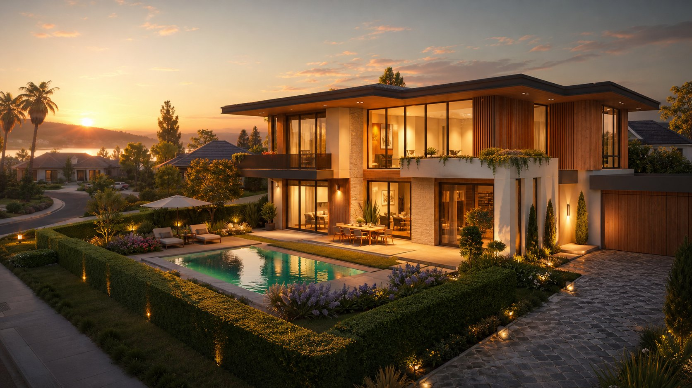

# Aurora · Vida em 3D

Um simulador de vida contemporâneo, inspirado em **The Sims** e **inZOI**, feito para rodar diretamente no navegador. O projeto combina uma casa 3D detalhada, materiais PBR procedurais, iluminação dinâmica, personagens autônomos, construção, carreiras, clima, relacionamentos e um sistema completo de saves.



## Destaques

- **Mundo 3D em tempo real** com Three.js, WebGL, sombras suaves, reflexos de ambiente, bloom, SMAA e câmera orbital com presets cinematográficos.
- **Texturas PBR procedurais** geradas em canvas: madeira, mármore, tecido, grama, pedra, tijolo, concreto, água, telas e obras de arte — com mapas de cor, normais e rugosidade.
- **Casa inicial completa** em um lote 22×22: seis ambientes, piscina, garagem, varanda, jardim, portas, janelas, dezenas de objetos modelados e três moradores.
- **Simulação viva**: necessidades, humor, traços, aspirações, autonomia, pathfinding A* com paredes e portas, habilidades, relacionamentos, contas, economia e conquistas.
- **8 carreiras** com cinco níveis, turnos, salários, desempenho e promoções.
- **Criar Sim** com pré-visualização 3D, tons de pele, penteados, roupas, altura, compleição, óculos, sardas, traços e aspirações.
- **Modo Construir**: catálogo com 50+ objetos, rotação, cores, pisos, paredes, portas, janelas, cômodos, pincel, venda com reembolso, undo/redo e fantasma de posicionamento válido/inválido.
- **Mundo dinâmico**: ciclo solar, céu shader, sol/lua, estrelas, nuvens, chuva, neve, tempestades com relâmpagos, estações e iluminação interna noturna.
- **Áudio procedural** WebAudio: interface, construção, clima, pássaros, chuva e trovão, sem arquivos externos.
- **Interface polida**: abertura cinematográfica, tutorial, HUD de necessidades/habilidades/carreira, diário, notificações, modo foto com exportação PNG e painéis responsivos.
- **Persistência**: autosave, três slots locais, exportação/importação JSON e validação/normalização de saves.
- **GitHub Pages**: workflow de build em qualquer branch e publicação automática em `main`.

## Tecnologias

| Camada | Escolha |
| --- | --- |
| Build | Vite 7 + TypeScript 5 |
| Interface | React 19 + CSS autoral |
| 3D | Three.js 0.187, OrbitControls, PMREM, EffectComposer, UnrealBloom, SMAA |
| Estado | Zustand 5 |
| Ícones | lucide-react |
| Áudio | WebAudio API |
| Texturas | Canvas 2D procedurais |
| Persistência | `localStorage` |

Node.js **20+** recomendado; o workflow usa Node 22.

## Como executar

```bash
npm ci
npm run dev
```

Abra o endereço mostrado pelo Vite. Em ambientes Arena, o preview é exposto automaticamente pelo servidor em `0.0.0.0:5173`.

Outros comandos:

```bash
npm run typecheck   # validação TypeScript
npm run build       # typecheck + bundle de produção em dist/
npm run preview     # serve o build de produção em 0.0.0.0:4173
```

## Primeiros passos no jogo

1. Na abertura, escolha **Começar nova história** ou continue um autosave.
2. Siga o tutorial flutuante ou abra a ajuda pelo ícone `?`.
3. No modo **Viver**, clique em um morador para torná-lo ativo; clique em objetos para ver interações; duplo clique executa a primeira ação; clique no chão para caminhar.
4. No modo **Construir**, escolha uma ferramenta, um item do catálogo ou um material. Use `R` para girar e `Alt + arraste` para orbitar sem trocar de ferramenta.
5. Abra **Carreiras** para contratar uma profissão e **Criar morador** para expandir a família.
6. Use **Saves** para gravar em slots, continuar o autosave ou exportar/importar um mundo em JSON.

## Controles

| Tecla / gesto | Ação |
| --- | --- |
| Arraste com botão esquerdo | Orbitar a câmera no modo Viver |
| Botão direito / roda | Pan / zoom |
| Clique no chão | Mover o morador ativo |
| Clique / duplo clique em objeto | Selecionar / executar primeira interação |
| `Espaço` | Pausar ou retomar |
| `1` `2` `3` | Velocidade 1×, 2×, 4× |
| `B` | Alternar Viver / Construir |
| `R` | Girar objeto ou pré-visualização |
| `Delete` | Vender objeto selecionado no modo Construir |
| `Ctrl+Z` / `Ctrl+Y` | Desfazer / refazer construção |
| `P` | Modo foto |
| `C` | Próxima câmera |
| `F` | Focar morador ativo |
| `G` / `O` | Alternar grade / telhado |
| `H` / `T` / `M` / `Q` | Ajuda / conquistas / carreiras / criar Sim |
| `Ctrl+S` | Abrir saves |
| `Esc` | Fechar painel, sair do modo foto ou deselecionar |

## Estrutura

```text
src/
├── App.tsx                 # HUD, atalhos, integração React ↔ mundo 3D
├── main.tsx                # entrada da aplicação
├── assets/hero.jpg         # arte de abertura
├── styles/                 # base, HUD e overlays
├── ui/                     # splash, tutorial, modais, avatar e preview 3D
└── game/
    ├── types.ts            # modelo de domínio e versão do save
    ├── constants.ts        # lote, relógio, metadados e helpers
    ├── data.ts             # objetos, interações, traços, carreiras e conquistas
    ├── lot.ts              # lote inicial, validação e economia do terreno
    ├── pathfinding.ts      # A* com paredes, portas e metas de objetos
    ├── simulation.ts       # necessidades, IA, trabalho, clima e progressão
    ├── store.ts            # Zustand: UI, construção, CAS, saves e autosave
    └── engine/             # texturas, materiais, modelos, arquitetura, ambiente, áudio e cena
```

## Saves e privacidade

Todo o progresso fica no navegador, em chaves `localStorage` com prefixo `aurora:`. Nenhuma conta, servidor ou serviço externo é necessário. O repositório GitHub guarda o código e os assets do jogo; os saves não são enviados para o repositório.

A importação aceita tanto um snapshot direto quanto um arquivo de slot com `{ "snapshot": ... }`. Saves antigos ou parcialmente corrompidos passam por normalização antes de entrar no estado global.

## Deploy

O workflow `.github/workflows/deploy.yml` roda `npm ci`, `npm run typecheck` e `npm run build` em qualquer branch. Quando o código está em `main`, o artefato `dist/` é publicado no GitHub Pages. A configuração `base: './'` do Vite permite servir o build tanto na raiz quanto em subpastas do Pages.

---

Feito para ser explorado: construa, observe, fotografe e deixe a casa contar a própria história. ✨
